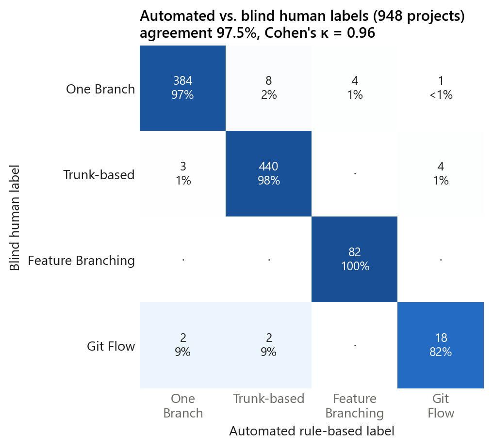
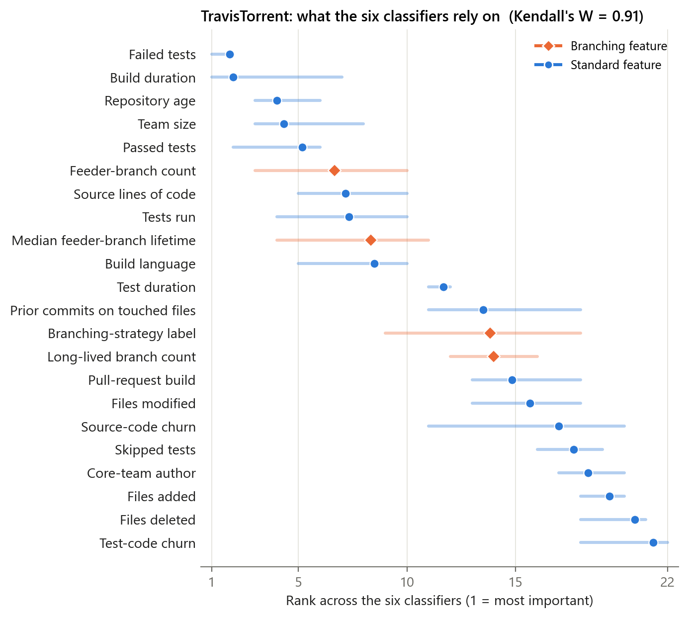
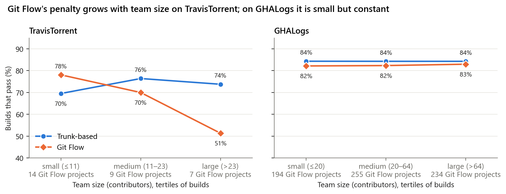
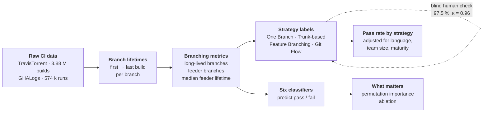

<div align="center">

# Does the way you branch change whether your build passes?

**Supplementary material for**
*"Assessing Impact of the Branching Strategy on Build Success of Software Projects"*
Hanan Moussa · Ahmed B. Atta · Esraa Hamouda — *IEEE Access*, 2026 (accepted)

Code, data and the full story behind every table and figure in the paper

**4.5 million CI builds** · **29,606 projects** · **Travis CI 2011–2016 and GitHub Actions 2023**

</div>

---

Every team chooses how to branch: commit straight to `main`, keep work on short-lived
branches, or run the full Git Flow of `develop`, `release/*` and `hotfix/*`. The choice is
usually made on taste and folklore. This repository asks what the builds say.

## What we found

### 1 · A branching strategy can be read from branch structure alone

Three measurements (how many long-lived branches, how many branches feed the main line,
and how long those feeder branches live) are enough to label a project's strategy. The
automated labels agree with a **blind human reviewer on 97.5 % of 948 projects (κ = 0.96)**,
and they reproduce exactly from the public raw data. → [Chapter 2](chapters/2_labeling)



### 2 · Tests and build time dominate; branching adds a consistent second signal

Six classifiers predict whether a build passes (best: LightGBM, **AUC-ROC 0.92** on
TravisTorrent, **0.78** on GitHub Actions). All six agree on what matters most: failed
tests and build duration on TravisTorrent; trigger event, run duration and log size on
GitHub Actions. Branching features rank next: **the feeder-branch count is in every
model's top ten** on TravisTorrent, and four branching features make the consensus top
ten on GitHub Actions. Removing them lowers AUC-ROC on both datasets (by 0.045 on
GitHub Actions). → [Chapters 3](chapters/3_prediction) and [4](chapters/4_what_matters)



### 3 · Git Flow passes fewer builds, and team size matters

On TravisTorrent, Git Flow projects pass **55.5 %** of builds against **73.3 %** for
trunk-based ones. After adjusting for language, team size and project age, Git Flow still
has **lower odds of a passing build on both datasets** (odds ratios 0.40 and 0.89). But
the penalty depends on team size. On TravisTorrent it appears only in large teams, and it
reverses in small ones. On GitHub Actions it is small and steady. The other strategies do
not differ significantly once confounders are accounted for. → [Chapter 5](chapters/5_strategy_and_success)



### 4 · The conclusions do not hinge on arbitrary choices

On TravisTorrent, trunk-based projects out-pass feature-branching ones for every
boundary between them from 1 to 14 days, not only at the 7 days we use. The ranking of
features barely moves between classifiers (Kendall's W = 0.91 and 0.87). And every
number in the paper can be regenerated from the public raw data with the scripts
here; [docs/paper_map.md](docs/paper_map.md) records how closely each one matches.
→ [Chapter 6](chapters/6_robustness)

### What the study does **not** show

It shows association, not causation. It says nothing about feature flags, dark launches or
canary releases, which usually accompany trunk-based development but are not recorded in
either dataset. And build success is a proxy for integration health, not for software
quality. Read [**docs/limitations.md**](docs/limitations.md) before citing a number.

---

## How the study works



## The chapters

Each chapter is a folder with a README (question, answer, figure, how to run) and the
scripts that produce its results. Read them in order for the full story, or jump in.

| | Chapter | The question it answers | Paper |
|---|---|---|---|
| 1 | [**Data**](chapters/1_data) | Where do 4.5 M builds come from, and how do I get them? | §IV |
| 2 | [**Labeling**](chapters/2_labeling) | Can a branching strategy be read from branch structure? How reliably? | §V-C |
| 3 | [**Prediction**](chapters/3_prediction) | How well can six classifiers predict a passing build? Are they really different? | Tables 3–6 |
| 4 | [**What matters**](chapters/4_what_matters) | Which features do the models rely on? Do branching features add anything? | Figs. 2–3, Table 9 |
| 5 | [**Strategy & success**](chapters/5_strategy_and_success) | Do strategies differ in pass rate? Is it the strategy or the project? | Tables 7, 8, 10 |
| 6 | [**Robustness**](chapters/6_robustness) | Do the conclusions survive other thresholds and settings? | §V-C, Table 5 |

Every table and figure of the paper is mapped to the script that produces it in
[**docs/paper_map.md**](docs/paper_map.md).

## Reproduce it

```bash
git clone https://github.com/besology512/branching-strategy-build-success.git && cd branching-strategy-build-success
python -m venv .venv && source .venv/bin/activate      # Windows: .venv\Scripts\activate
pip install -r requirements.txt
# download the two datasets into data/raw/  (see chapters/1_data)
python run_all.py --list      # the steps and their run times
python run_all.py --fast      # the steps that take minutes (labels, pass rates, confounders)
python run_all.py             # everything (~6 h on an 8-core laptop, ~16 GB RAM)
```

Every script can also be run on its own. Results go to [`results/`](results) (CSV) and
[`figures/`](figures). Both are committed, so you can read every number without running
anything.

```
branching-strategy-build-success/
├── chapters/        the story: one folder per chapter, each with README + scripts
├── src/bsci/        shared code, defined once: data loaders, labeling rules, models, figure style
├── data/derived/    small versioned artefacts: strategy labels, branch lifetimes, repo metadata
├── results/         every table, as CSV, by chapter
├── figures/         every figure
├── docs/            limitations, paper-to-code map
└── run_all.py       runs the chapters in order
```

## Cite

```bibtex
@article{moussa2026branching,
  title   = {Assessing Impact of the Branching Strategy on Build Success of Software Projects},
  author  = {Moussa, Hanan and Atta, Ahmed B. and Hamouda, Esraa},
  journal = {IEEE Access},
  year    = {2026},
  note    = {Accepted. Code and data: \url{https://github.com/besology512/branching-strategy-build-success}}
}
```

Please also cite the datasets: TravisTorrent (Beller, Gousios & Zaidman, MSR 2017) and
GHALogs (Moriconi et al., MSR 2025).

**License.** Code: MIT. Derived data, results and figures: CC BY 4.0. The raw datasets are
not redistributed. See [LICENSE](LICENSE).
