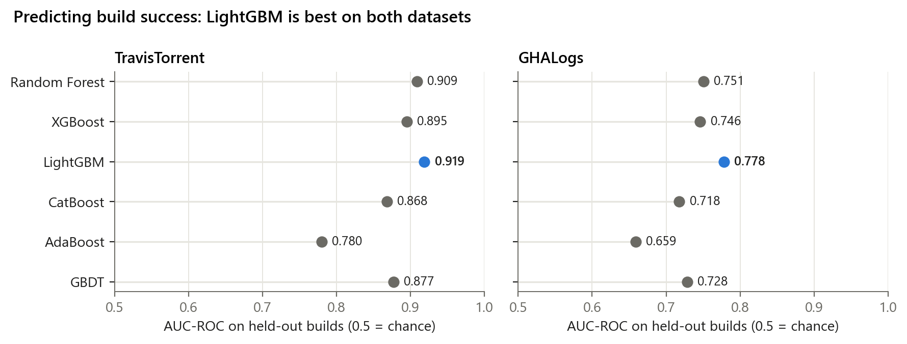

# Chapter 3 · Can a build's outcome be predicted?

> **Question.** Given what is known about a build (its tests, duration, the change, the
> repository, and the project's branching structure), how well can standard classifiers
> tell a passing build from a failing one? And are the differences between classifiers
> real?
>
> **Short answer.** Well on TravisTorrent (best AUC-ROC **0.92**) and moderately on GitHub
> Actions (**0.78**). LightGBM is best on both, and significantly so (Friedman
> p < 0.001).

The classifiers are an instrument, not the contribution. Chapter 4 opens them up to ask
*what* they rely on. Build-outcome prediction has a literature of its own (Xia & Li 2017;
Ni & Li 2017; BuildFast, ASE 2020), and none of it uses branch structure.

## Setup

| | TravisTorrent | GHALogs |
|---|---|---|
| unit | build job | workflow run |
| features | 43 (after one-hot encoding) | 47 (after one-hot encoding of trigger event and strategy) |
| class balancing | SMOTE across the four strategies | none |
| training data | 500,000-row stratified sample of the balanced table | all 573,993 runs |
| split | stratified 80 / 20, seed 42 | stratified 80 / 20, seed 42 |

The six models and their settings (Table 5) are defined once in
[`src/bsci/models.py`](../../src/bsci/models.py): Random Forest (200 trees, depth 15),
XGBoost (200, lr 0.1, depth 6), LightGBM (200, lr 0.1, 63 leaves), CatBoost (200, lr 0.1,
depth 6), AdaBoost (200, lr 1.0), and histogram gradient boosting "GBDT" (200, lr 0.1,
depth 5).

## Results

| Model | TravisTorrent accuracy | TravisTorrent F1 | **TravisTorrent AUC-ROC** | GHALogs accuracy | GHALogs F1 | **GHALogs AUC-ROC** |
|---|---:|---:|---:|---:|---:|---:|
| **LightGBM** | **0.867** | **0.860** | **0.919** | **0.858** | **0.809** | **0.778** |
| Random Forest | 0.845 | 0.835 | 0.909 | 0.854 | 0.798 | 0.751 |
| XGBoost | 0.843 | 0.833 | 0.895 | 0.855 | 0.804 | 0.746 |
| GBDT | 0.827 | 0.816 | 0.877 | 0.854 | 0.800 | 0.728 |
| CatBoost | 0.821 | 0.809 | 0.868 | 0.853 | 0.799 | 0.718 |
| AdaBoost | 0.768 | 0.748 | 0.780 | 0.851 | 0.793 | 0.659 |

Precision and recall are in
[`results/3_prediction/performance.csv`](../../results/3_prediction/performance.csv).
Metrics are weighted averages over the two classes.

**Reading it.** On GHALogs every model reaches about 85 % accuracy, but 84 % of runs pass,
so accuracy says little there. AUC-ROC, which does not depend on the class balance,
separates the models. The TravisTorrent scores are optimistic because SMOTE ran before
the split ([limitations](../../docs/limitations.md#about-the-models)). Compare the models
with each other, not with other studies.

**Reproduction.** Random Forest, GBDT, AdaBoost and LightGBM reproduce Tables 3 and 4 to
four decimals. XGBoost and CatBoost differ by at most 0.0011 AUC-ROC on either dataset,
because their training is not bit-for-bit deterministic across library versions and
hardware. (Before the final revision, Table 4 printed the GHALogs LightGBM row from an
earlier run, 0.7770. The final manuscript reports 0.7781, the value this code
reproduces.)

## Are the differences real?

Five-fold stratified cross-validation, a Friedman test across folds, and Nemenyi
post-hoc comparisons (Demšar, 2006).

| Model | TravisTorrent, mean AUC-ROC ± SD | GHALogs, mean AUC-ROC ± SD |
|---|---:|---:|
| **LightGBM** | **0.898 ± 0.002** | **0.750 ± 0.001** |
| Random Forest | 0.878 ± 0.003 | 0.716 ± 0.001 |
| XGBoost | 0.871 ± 0.003 | 0.721 ± 0.001 |
| GBDT | 0.857 ± 0.003 | 0.710 ± 0.001 |
| CatBoost | 0.850 ± 0.003 | 0.704 ± 0.002 |
| AdaBoost | 0.764 ± 0.004 | 0.641 ± 0.002 |

Friedman χ² = 25.0, p = 0.00014 on both datasets. This is the largest χ² possible
with six models and five folds: the models finished in the same order in every fold.

| Nemenyi post-hoc test | TravisTorrent p | GHALogs p |
|---|---:|---:|
| LightGBM vs AdaBoost | **0.0003** | **0.0003** |
| LightGBM vs CatBoost | **0.009** | **0.009** |
| LightGBM vs GBDT | 0.11 | 0.11 |
| Random Forest vs XGBoost vs GBDT | ≥ 0.54 | ≥ 0.54 |

**Reading it.** LightGBM is significantly better than AdaBoost and CatBoost. Random
Forest, XGBoost and GBDT form a second tier that the test cannot separate. With five
folds, the Nemenyi test is conservative, so smaller gaps may still be real. All
pairwise p-values are in
[`results/3_prediction/nemenyi_pvalues.csv`](../../results/3_prediction/nemenyi_pvalues.csv).
Cross-validated scores are lower than the single-split scores above because each fold
trains on a different 80 % and the models are lighter (see the note below).

**Reproduction.** The Friedman statistic, the Nemenyi p-values and the Random Forest
and GBDT rows (and LightGBM on GHALogs) match Table 6 exactly. XGBoost, CatBoost and
LightGBM on TravisTorrent are within 0.002. AdaBoost comes out lower than the published
values (0.764 vs 0.788; 0.641 vs 0.680). The configuration is the same, so the likely
cause is scikit-learn: AdaBoost used the SAMME.R algorithm by default up to version 1.3
(the version in the paper's Table 2), and version 1.6 removed it, leaving only SAMME.
AdaBoost is last either way, and no conclusion changes.

> Table 6 was computed with a lighter configuration than Table 5 (100 trees; Random Forest
> depth 12; AdaBoost learning rate 0.5; a 300,000-row TravisTorrent sample).
> [`significance.py`](significance.py) reproduces it as it was run.

## Run it

| Script | Does | Time |
|---|---|---|
| [`build_travis_table.py`](build_travis_table.py) | raw builds → encoded, SMOTE-balanced table (cached) | ~35 min, ~16 GB RAM |
| [`performance.py`](performance.py) | Tables 3–4 and the figure | ~30 min |
| [`significance.py`](significance.py) | Table 6, Friedman and Nemenyi tests | ~1.5 h |

**Paper:** Tables 3–6 · Section VI-A/B ·
**Limitations:** [SMOTE before the split makes TravisTorrent scores optimistic](../../docs/limitations.md#about-the-models)
