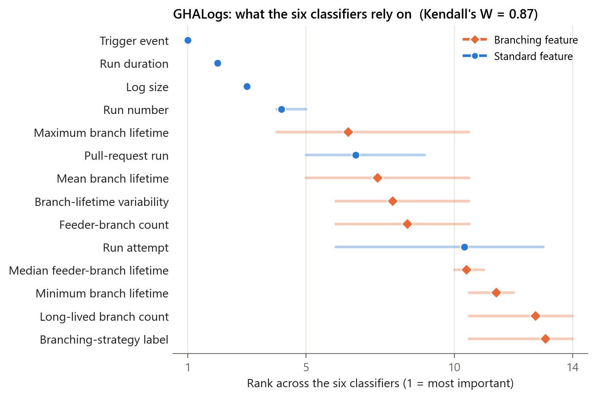
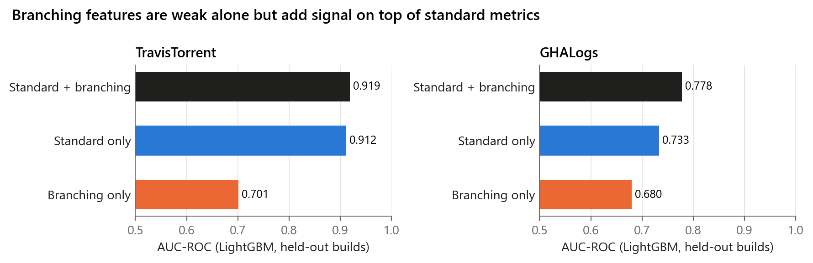

# Chapter 4 · What do the models rely on, and do branching features add anything?

> **Question.** Chapter 3's classifiers predict build outcomes well. Is that because of
> the branch structure, or despite it?
>
> **Short answer.** Mostly despite it. Tests and build duration carry the bulk of the
> signal. Branching features are secondary but consistently present: the feeder-branch
> count sits in every model's top ten on TravisTorrent, and removing the branching
> features lowers AUC-ROC on both datasets.

## 1 · Asking all six models the same question

Built-in importance scores cannot be compared across algorithms. Random Forest and
AdaBoost report impurity reduction, XGBoost and LightGBM split gain, and CatBoost
prediction-value change, and impurity scores favour features with many split points
(Strobl et al., 2007). So we ask every model the same question: *how much does test
AUC-ROC drop when this feature is shuffled?* This is held-out **permutation importance**,
expressed in the same unit for every model. One-hot variables are shuffled as a group.
Each model ranks the features; the consensus orders them by **mean rank**, and
**Kendall's W** measures how far the six models agree (0 = not at all, 1 = identically).

*Dot: mean rank across the six classifiers. Bar: best to worst rank. Diamonds: branching
features.*

| Rank | TravisTorrent | models with it in top 10 | GHALogs | models with it in top 10 |
|---:|---|:---:|---|:---:|
| 1 | Failed tests | 6 / 6 | Trigger event | 6 / 6 |
| 2 | Build duration | 6 / 6 | Run duration | 6 / 6 |
| 3 | Repository age | 6 / 6 | Log size | 6 / 6 |
| 4 | Team size | 6 / 6 | Run number | 6 / 6 |
| 5 | Passed tests | 6 / 6 | ◆ Maximum branch lifetime | 5 / 6 |
| 6 | ◆ **Feeder-branch count** | **6 / 6** | Pull-request run | 6 / 6 |
| 7 | Source lines of code | 6 / 6 | ◆ Mean branch lifetime | 5 / 6 |
| 8 | Tests run | 6 / 6 | ◆ Branch-lifetime variability | 5 / 6 |
| 9 | ◆ Median feeder-branch lifetime | 5 / 6 | ◆ **Feeder-branch count** | 5 / 6 |
| 10 | Build language | 6 / 6 | Run attempt | 3 / 6 |

◆ = branching feature. Kendall's W = **0.91** on TravisTorrent and **0.87** on GHALogs
(both p < 10⁻⁸): the six models largely agree on the order. Per-model ranks and the
drop in AUC-ROC are in
[`results/4_what_matters/`](../../results/4_what_matters/) (`importance_*_per_model.csv`,
`importance_*_consensus.csv`).

**Reading it.** The strongest predictors describe the build itself: its tests, its
duration, the event that triggered it. Branching features come next and are not
noise. Every model puts the feeder-branch count in its top ten on TravisTorrent, and
four branching features make the consensus top ten on GHALogs. The categorical
**strategy label** ranks low on both datasets. The models get more from the
measurements behind the label than from the label itself.

> **Caution.** "Failed tests" is recorded as part of the build that is being predicted,
> so it is close to the outcome. It is kept for comparability with the TravisTorrent
> literature. See [limitations](../../docs/limitations.md#about-the-models).

## 2 · Removing the branching features

LightGBM trained on standard features only, on branching features only, and on both,
and evaluated on the same held-out builds.

| Features | TravisTorrent accuracy | **TravisTorrent AUC-ROC** | GHALogs accuracy | **GHALogs AUC-ROC** |
|---|---:|---:|---:|---:|
| Standard + branching (all) | **0.867** | **0.919** | **0.858** | **0.778** |
| Standard only | 0.860 | 0.912 | 0.854 | 0.733 |
| Branching only | 0.711 | 0.701 | 0.843 | 0.680 |
| *gain from adding branching* | *+0.007* | *+0.007* | *+0.004* | ***+0.045*** |

**Reading it.** Branching features alone are weaker than the standard build metrics.
They describe the project, not the individual build, so on their own they cannot tell
one build from the next. Added to the standard metrics, they raise AUC-ROC on both
datasets, and by a larger margin on GHALogs (+0.045), where the standard metrics are
thinner. Branching structure refines the prediction; it does not replace it.

<b>Note on grouping: why TravisTorrent shows 0.912 here and 0.910 in the paper</b>

In the published ablation (Table 9), a naming slip dropped the 19 build-language
indicators and the 4 strategy indicators from *both* the "standard only" and the
"branching only" sets on TravisTorrent. Those sets therefore had 17 and 3 features,
not 36 and 7. [`ablation.py`](ablation.py) reproduces the published grouping exactly
(0.9104 / 0.6989 / 0.9187) and also runs the corrected one shown above. The conclusion
is the same under both: branching features add signal (+0.008 published, +0.007
corrected). GHALogs is unaffected. Both groupings are in
[`results/4_what_matters/ablation.csv`](../../results/4_what_matters/ablation.csv).

## 3 · Supplementary: pruning the model

Retraining LightGBM on only its top-K features shows where accuracy plateaus, and
whether branching features survive the cut. Results:
[`results/4_what_matters/feature_selection.csv`](../../results/4_what_matters/feature_selection.csv).

| Features kept | 5 | 10 | 15 | 20 | 25 | 30 | all |
|---|---:|---:|---:|---:|---:|---:|---:|
| TravisTorrent AUC-ROC | 0.870 | 0.889 | 0.916 | 0.918 | 0.919 | 0.919 | 0.919 (43) |
| branching features among them | 0 | 2 | 2 | 3 | 3 | 3 | 3 |
| GHALogs AUC-ROC | 0.732 | 0.746 | 0.771 | 0.778 | 0.777 | 0.777 | 0.778 (47) |
| branching features among them | 2 | 7 | 7 | 7 | 7 | 7 | 7 |

**Reading it.** About 15–20 columns recover the full model on both datasets. The
TravisTorrent top ten already contains the feeder-branch count and the median
feeder-branch lifetime. On GHALogs, all seven numeric branching features are in the top
ten. The pruned models keep them, so they are not redundant with the standard metrics.
Features are ranked here by LightGBM's own split counts, a cruder measure than the
permutation importance above, so treat this as a sanity check.

## Run it

| Script | Does | Time |
|---|---|---|
| [`feature_importance.py`](feature_importance.py) | Figures 2–3: permutation importance, consensus ranks, Kendall's W | ~45 min |
| [`ablation.py`](ablation.py) | Table 9, both groupings | ~10 min |
| [`feature_selection.py`](feature_selection.py) | supplementary pruning curve | ~10 min |

**Paper:** Figures 2–3, Table 9, Section V-D and VI-A/B ·
**Limitations:** [near-outcome features; SMOTE and absolute TravisTorrent scores](../../docs/limitations.md#about-the-models)
