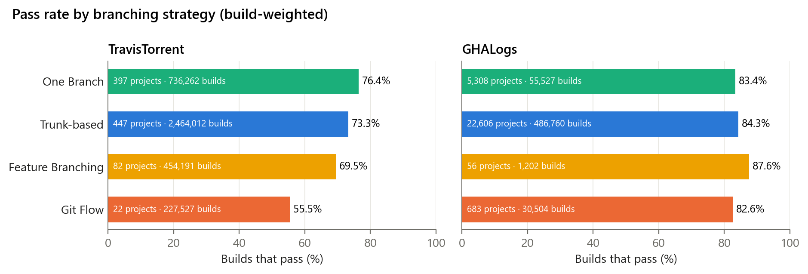

# Chapter 5 · Does the strategy change how often builds pass?

> **Question.** Do projects that integrate in small, frequent steps pass more builds than
> projects that keep long-lived release branches? And is that about the strategy, or
> about the kind of project that adopts it?
>
> **Short answer.** Git Flow passes fewer builds on both datasets, and this survives
> adjustment for language, team size and project maturity. The size of the penalty
> depends on the project: on TravisTorrent it appears only in large teams, while on
> GHALogs it is small but consistent. The other three strategies do not differ
> significantly once confounders are accounted for.

## 1 · The raw picture

| Strategy | TravisTorrent pass rate | builds | GHALogs pass rate | runs |
|---|---:|---:|---:|---:|
| One Branch | 76.4 % | 736,262 | 83.4 % | 55,527 |
| Trunk-based | 73.3 % | 2,464,012 | 84.3 % | 486,760 |
| Feature Branching | 69.5 % | 454,191 | 87.6 %* | 1,202 |
| Git Flow | **55.5 %** | 227,527 | **82.6 %** | 30,504 |

\* 56 repositories only, indicative. GHALogs rates cluster in a narrow band because its
selection favoured mature CI pipelines.

On TravisTorrent, Git Flow trails trunk-based development by **17.8 percentage points**.
These are *build-weighted* rates, though, and the next section shows why that matters.

## 2 · Is it the strategy, or the project?

Language, team size and project age may each go with both the strategy and the build
outcome. Three checks:

1. **Adjusted regression.** Logistic regression of build success on strategy, language,
   log₂ team size and project age, with standard errors clustered by project.
2. **Team size as a moderator.** The same model with strategy × team-size interactions.
3. **One vote per project.** Each project's own pass rate, counted once.

| | TravisTorrent | GHALogs |
|---|---|---|
| projects · builds | 948 · 3,881,992 | 28,642 · 573,831 |
| Git Flow projects | 22 | 683 |
| **Git Flow vs trunk-based, adjusted odds ratio** | **0.40** (0.17–0.95) | **0.89** (0.80–0.99) |
| One Branch vs trunk-based | 1.17 (0.90–1.53) | 0.93 (0.85–1.01) |
| Feature Branching vs trunk-based | 0.85 (0.63–1.15) | 1.31 (0.91–1.90) |
| strategy × team size, χ²(3) | **14.5, p = 0.002** | 4.2, p = 0.24 |
| median project pass rate: trunk-based / Git Flow | 81.7 % / 82.1 % (p = 0.88) | 90.0 % / 86.7 % (p < 0.001, Cliff's δ = 0.15) |

An odds ratio below 1 means lower odds of a passing build than trunk-based development.

**What this shows.**

* On **GHALogs** (683 Git Flow repositories) the penalty is small and holds everywhere:
  Git Flow passes the fewest builds in every team-size band and in four of six language
  groups.
* On **TravisTorrent** (22 Git Flow projects) the penalty depends on team size. With more
  than 23 contributors, Git Flow passes 51 % of builds against 74 % for trunk-based; with
  11 or fewer it passes *more* (78 % vs 70 %). Three projects contribute 80.6 % of all
  Git Flow builds, and counted one vote per project, Git Flow and trunk-based do not
  differ. The 17.8-point gap describes large Git Flow projects, not the typical one.

**A plausible mechanism (a hypothesis, not a finding).** In Git Flow, changes accumulate
on a long-lived development branch and reach the main branch only through release and
hotfix branches, which must then be merged back. The more contributors add changes
between releases, the larger each batch that crosses those branches, and the more room
for integration failures. Our data show *that* the penalty grows with team size, not
*why*.

(Team size is recorded per build, so a project whose team grew can appear in more than
one band.)

## Run it

| Script | Does | Time |
|---|---|---|
| [`success_rates.py`](success_rates.py) | Tables 7–8 and the pass-rate figure | ~3 min |
| [`confounders.py`](confounders.py) | Table 10: regressions, interaction, project level, strata, team-size figure | ~20 min |

Full stratified tables (every language, team-size and maturity band):
[`results/5_strategy_and_success/confounders_stratified_rates.csv`](../../results/5_strategy_and_success/confounders_stratified_rates.csv)

**Paper:** Tables 7, 8, 10 · Section VI-C · RQ3–RQ4 ·
**Limitations:** [association not causation; few Git Flow projects on TravisTorrent; unobserved practices such as feature flags](../../docs/limitations.md)
