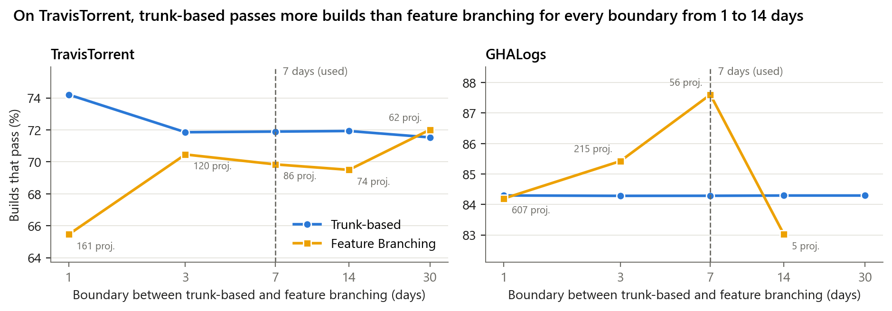
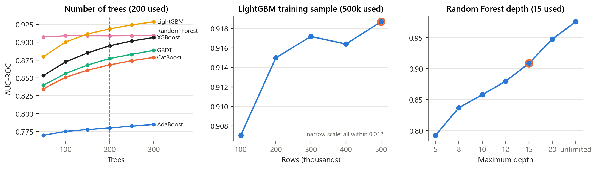

# Chapter 6 · Would different choices change the conclusions?

> **Question.** Several numbers in this study were chosen: 7 days to separate trunk-based
> development from feature branching, 200 trees, a depth of 15, a 500,000-build sample.
> Do the conclusions depend on them?
>
> **Short answer.** Not the ones that matter. On TravisTorrent, trunk-based projects
> out-pass feature-branching ones at every boundary between 1 and 14 days. Model accuracy
> is flat in the training-sample size beyond ~300,000 builds. The gradient-boosting
> models were still improving slowly at 200 trees, so if anything their scores are
> conservative.

## 1 · The 7-day boundary

Projects are relabelled with the boundary set to 1, 3, 7, 14 and 30 days (One-Branch and
Git Flow do not depend on it), and pass rates are recomputed.

| Boundary | 1 day | 3 days | **7 days** | 14 days | 30 days |
|---|---:|---:|---:|---:|---:|
| TravisTorrent trunk-based | 74.2 % | 71.9 % | **71.9 %** | 71.9 % | 71.5 % |
| TravisTorrent feature branching | 65.5 % | 70.5 % | **69.8 %** | 69.5 % | 72.0 % |
| gap (points) | **+8.75** | +1.39 | **+2.05** | +2.43 | −0.48 |
| GHALogs feature-branching repositories | 607 | 215 | **56** | 5 | 0 |

**Reading it.** A 1-day boundary separates the two strategies most, but it calls a
project "feature branching" as soon as its typical branch outlives a working day. 7 days
follows the trunk-based-development literature and keeps the ordering. At 30 days the
two groups converge. On GHALogs, feeder branches are short-lived almost everywhere, so
the feature-branching group shrinks from 607 repositories at 1 day to 5 at 14 days, and
its pass rate swings with the few repositories that remain.

(These rates use the automated labels, so they differ slightly from Table 8, which uses
the human labels.)

## 2 · Supplementary: hyperparameters (Table 5)

Each setting in Table 5 is varied while the others stay fixed. The model is retrained
on TravisTorrent and scored on the same held-out builds as Table 3. The orange ring
marks the value the paper uses.

| Setting | Tried | Used | What happens |
|---|---|---|---|
| number of trees | 50–300 | 200 | Random Forest is flat from 100 trees (0.909). The boosting models still gain 0.005–0.012 AUC-ROC from 200 to 300 trees, so the published scores are, if anything, conservative. |
| AdaBoost learning rate | 0.1–1.0 | 1.0 | AUC-ROC rises steadily with the rate, from 0.744 to 0.780; 1.0 is best. |
| LightGBM training sample | 100k–500k rows | 500k | AUC-ROC moves within 0.012 across the range (0.907 → 0.919), and by about 0.002 beyond 300k. |
| Random Forest depth | 5 – unlimited | 15 | AUC-ROC keeps climbing, up to 0.976 unlimited. |

**Reading it.** None of these choices drives the conclusions. They affect the absolute
scores, not which model wins or which features matter. The Random Forest depth curve
needs care. Deeper trees memorise more of the training set, and because SMOTE ran
before the split, test builds were interpolated from training builds, so memorising
pays off on the test set. The climb to 0.976 is mostly this leak, not real
generalisation. Depth 15 is a deliberate cap
([limitations](../../docs/limitations.md#about-the-models)). No separate validation
split was held out for this tuning.

**Reproduction.** Every point on the learning-rate, sample-size and depth curves, and
the LightGBM and XGBoost tree curves, match the authors' original tuning run to four decimals. The other tree curves differ because the original run used different
settings for those models; the curves here use the Table 5 configuration.
Numbers: [`results/6_robustness/hyperparameters.csv`](../../results/6_robustness/hyperparameters.csv).

## Run it

| Script | Does | Time |
|---|---|---|
| [`threshold_sensitivity.py`](threshold_sensitivity.py) | relabel at 1–30 days, pass rates, figure | ~3 min |
| [`hyperparameters.py`](hyperparameters.py) | learning curves behind Table 5 | ~2–3 h |

**Paper:** Section V-C (seven-day threshold); Table 5
